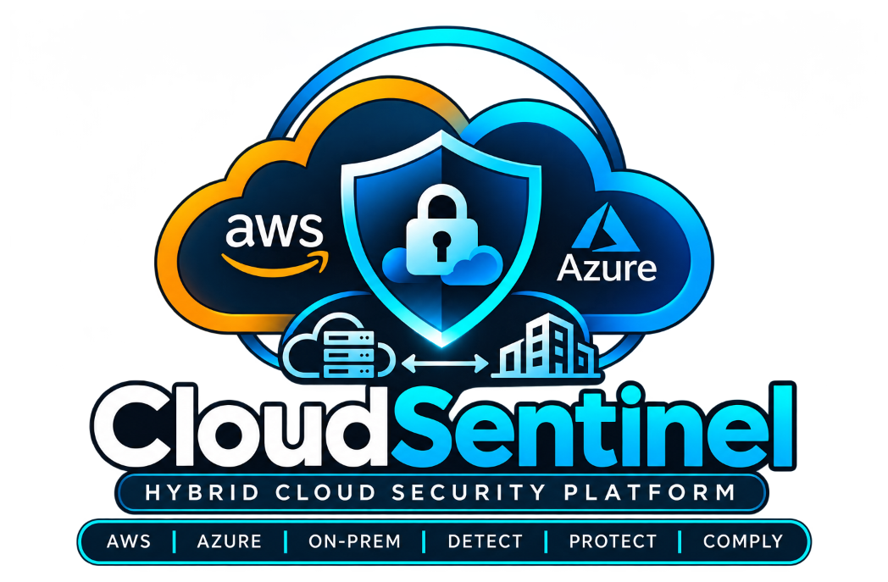
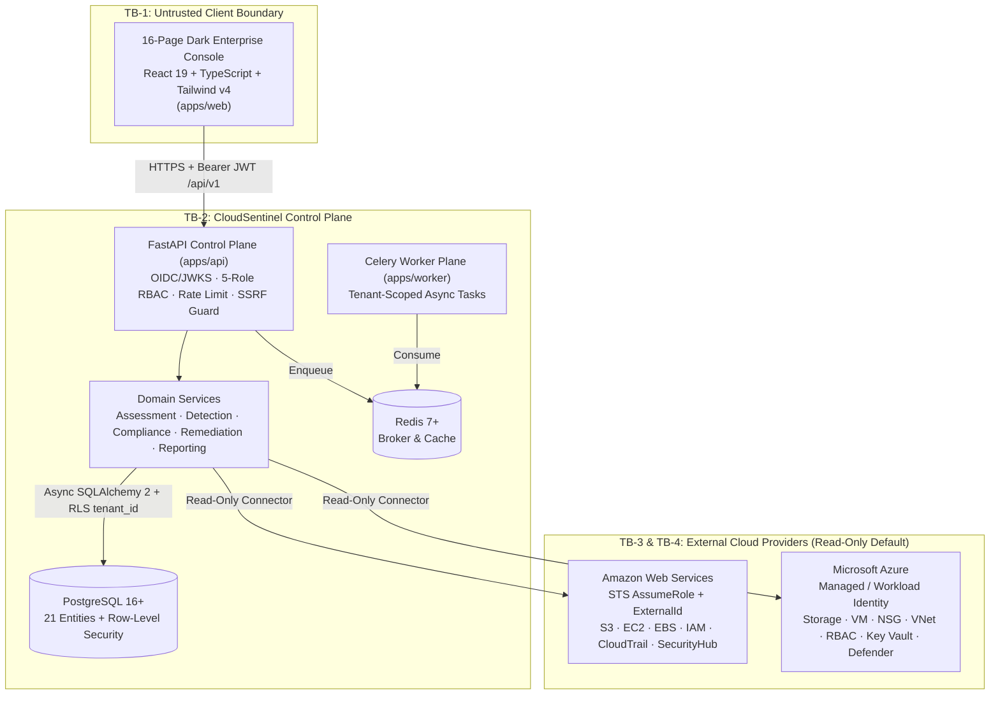
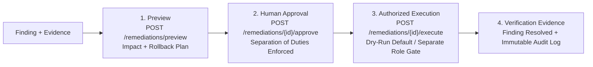
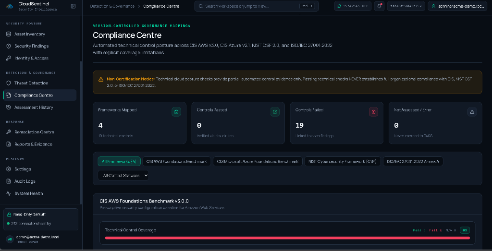

<p align="center">
  
</p>

# CloudSentinel

**Enterprise Multi-Cloud Security Posture Management (CSPM) & Threat Detection Platform for Amazon Web Services (AWS) and Microsoft Azure**

[](pyproject.toml)
[](apps/api/README.md)
[](apps/web/README.md)
[](cloud_connectors/aws/README.md)
[](cloud_connectors/azure/README.md)
[](docs/DATABASE_SCHEMA.md)
[](LICENSE)
[](https://abarjun.online)

> **Version `1.0.0` — Milestones 0–9 Implemented & Verified**
> CloudSentinel is a full-scope, multi-tenant cloud security control plane engineered under a strict **Proof Before Action** operating contract. It combines read-only AWS & Azure asset discovery, 18 deterministic posture rules, IAM/RBAC identity risk analysis, CloudTrail & Azure Activity Log threat detection mapped to MITRE ATT&CK, transparent risk scoring, version-controlled compliance mappings, approval-gated remediation with separation of duties, evidence-backed JSON/CSV/PDF reporting, and a 16-page dark-enterprise web console.
>
> **Engineering Integrity Notice**: Public CI and local verification suites run against explicitly labeled synthetic provider fixtures (`data_source="synthetic_fixture"`). Live cloud scans require your own isolated AWS sandbox account and/or Azure subscription credentials — raw credentials are never bundled in source code, git history, frontend bundles, or database columns.

---

## Table of Contents

1. [Core Philosophy: Proof Before Action](#1-core-philosophy-proof-before-action)
2. [System Architecture & Trust Boundaries](#2-system-architecture--trust-boundaries)
3. [Technology Stack](#3-technology-stack)
4. [Product Modules (M01–M11)](#4-product-modules-m01m11)
   - [AWS & Azure Security Rule Catalog (18 Rules)](#aws--azure-security-rule-catalog-18-deterministic-rules)
   - [Cloud Threat Detection Catalog (9 MITRE ATT&CK Rules)](#cloud-threat-detection-catalog-9-deterministic-rules)
   - [Transparent Risk Scoring Model](#transparent-risk-scoring-model-0100)
   - [Compliance Framework Mappings](#compliance-framework-mappings)
   - [Safe Remediation Lifecycle](#safe-remediation-lifecycle-read-only-default)
5. [Security Architecture & Multi-Tenancy](#5-security-architecture--multi-tenancy)
6. [REST API Surface](#6-rest-api-surface)
7. [Database Schema (21 Entities + PostgreSQL RLS)](#7-database-schema-21-entities--postgresql-rls)
8. [16-Page Dark Enterprise Console](#8-16-page-dark-enterprise-console)
9. [Repository Structure](#9-repository-structure)
10. [Quick Start & Local Development](#10-quick-start--local-development)
11. [Testing, Security Scans & CI/CD](#11-testing-security-scans--cicd)
12. [Honest Boundaries & Pre-Production Checklist](#12-honest-boundaries--pre-production-checklist)
13. [Documentation Index](#13-documentation-index)
14. [Author](#14-author)
15. [License](#15-license)

---

## 1. Core Philosophy: Proof Before Action

- **Reproducible Evidence**: Every finding records its `rule_id`, `rule_version`, provider, account/subscription, resource ARN/ID, expected vs. observed configuration, redacted evidence snapshot, risk score breakdown, remediation guidance, and explicit analysis limitations.
- **No Fabricated Security Claims**: Every check resolves strictly to `PASS`, `FAIL`, `NOT_ASSESSED`, or `ERROR`. Failed cloud API calls, throttled requests, or unreachable backing services are **never** coerced into `PASS` or healthy readiness.
- **Read-Only by Default**: Assessment identities require read-only permissions only. Live cloud remediation is disabled by default (`CLOUDSENTINEL_LIVE_REMEDIATION_ENABLED=false`) and requires preview, impact analysis, rollback guidance, human approval, **separation of duties** (`approver != proposer`), and a separate remediation role.
- **Explicit Fixture Separation**: Demonstration/test datasets carry `data_source="synthetic_fixture"` and trigger visible badges and warning banners across the console and exported reports.

---

## 2. System Architecture & Trust Boundaries



### Trust Boundaries Enforced
- **TB-1 (Browser ↔ API)**: Pydantic v2 input validation, strict CORS allowlist (wildcards stripped), pure ASGI security headers, HTTP `429` sliding-window rate limiting, OIDC JWT verification, and server-derived `tenant_id`.
- **TB-2 (API ↔ Worker / DB)**: Every ORM query filters on verified `auth.tenant_id`, PostgreSQL RLS enforces `app.current_tenant_id`, and worker tasks reject unscoped execution.
- **TB-3 (Connectors ↔ AWS / Azure)**: Short-lived read-only credentials, bounded timeouts, pagination, SSRF validation on outbound URLs, and recursive redaction before persisting responses.
- **TB-4 (Assessment ↔ Remediation)**: Separate remediation role required for live execution; dry-run preview + human approval + separation of duties mandatory.

---

## 3. Technology Stack

| Layer | Technologies (Pinned Versions) |
| :--- | :--- |
| **Backend API** | Python `3.12+`, FastAPI `0.115.12`, Uvicorn `0.34.0`, Pydantic `2.10.6`, pydantic-settings `2.8.1`, `httpx 0.28.1` |
| **Database & Queue** | PostgreSQL `16+` (SQLite `aiosqlite` test variant), SQLAlchemy `2.0.38` (asyncio), `asyncpg 0.30.0`, Alembic `1.14.1`, Celery `5.4.0`, Redis `5.2.1` |
| **Auth & Reporting** | `PyJWT[crypto] 2.10.1` (RS256/ES256 JWKS + dev HS256), `fpdf2 2.8.2` (PDF), CSV & JSON exporters |
| **Cloud SDKs** | `boto3 1.36.26` (AWS STS/S3/EC2/IAM/CloudTrail/SecurityHub/GuardDuty), `azure-identity 1.20.0` + ARM REST (`httpx`) |
| **Frontend Console** | React `19.0.0`, TypeScript `5.7.3` (strict), Vite `6.4.6`, Tailwind CSS `4.1.11`, TanStack Query `5.66.0`, React Router `7.18.6`, Recharts `2.15.1`, Lucide React `0.475.0` |
| **Security & DevSecOps** | Ruff `0.9.9`, Mypy `1.15.0` (`--strict`), Pytest `8.3.5`, Vitest `5.1.1`, Bandit, Semgrep, OPA Rego, Terraform, Checkov, Gitleaks, Trivy, Prowler (manual sandbox), Docker Compose |

---

## 4. Product Modules (M01–M11)

| Module | Capability Summary | Source |
| :--- | :--- | :--- |
| **M01 — Security Operations Dashboard** | Live multi-cloud KPIs, Recharts severity distribution, connector health, recent assessments, compliance summary, synthetic-fixture banners | [`apps/api/api/v1/dashboard.py`](apps/api/api/v1/dashboard.py), [`DashboardPage.tsx`](apps/web/src/pages/DashboardPage.tsx) |
| **M02 — Cloud Connector Management** | AWS STS `AssumeRole` + `ExternalId` (rejects `:root`), Azure Managed/Workload Identity & controlled SP, permission preflight checks | [`cloud_connectors/aws/`](cloud_connectors/aws/README.md), [`cloud_connectors/azure/`](cloud_connectors/azure/README.md) |
| **M03 — Cloud Asset Inventory** | Deduplicated AWS (S3, EC2, SG, IAM, EBS) & Azure (VM, Storage, NSG, VNet, Key Vault) discovery with pagination & partial-failure tracking | [`apps/api/services/assessment_service.py`](apps/api/services/assessment_service.py), [`AssetsPage.tsx`](apps/web/src/pages/AssetsPage.tsx) |
| **M04 — Cloud Posture Assessment** | Unified `CloudProviderConnector` interface, 18 deterministic rules returning `PASS`/`FAIL`/`NOT_ASSESSED`/`ERROR`, redacted evidence | [`packages/assessment/`](packages/assessment/), [`cloud_connectors/`](cloud_connectors/) |
| **M05 — Identity & Access Security** | AWS IAM wildcards, admin users, missing MFA, risky trust policies; Azure subscription Owners & overprivileged Service Principals + explicit limitations | [`apps/api/api/v1/cspm.py`](apps/api/api/v1/cspm.py), [`IdentityPage.tsx`](apps/web/src/pages/IdentityPage.tsx) |
| **M06 — Cloud Threat Detection** | CloudTrail & Azure Activity Log normalization, 9 deterministic rules, 30-min actor event correlation, MITRE ATT&CK mapping, disposition workflow | [`detections/engine.py`](detections/engine.py), [`DetectionsPage.tsx`](apps/web/src/pages/DetectionsPage.tsx) |
| **M07 — Risk Management** | Transparent 0–100 risk engine with factor breakdown, priority tiers, risk acceptance workflow, and immutable `finding_history` | [`packages/assessment/risk.py`](packages/assessment/risk.py), [`FindingDetailPage.tsx`](apps/web/src/pages/FindingDetailPage.tsx) |
| **M08 — Compliance & Governance** | Version-controlled CIS AWS v3.0, CIS Azure v2.1, NIST CSF 2.0, and ISO/IEC 27001:2022 mappings with explicit coverage limitations | [`compliance/frameworks.json`](compliance/frameworks.json), [`CompliancePage.tsx`](apps/web/src/pages/CompliancePage.tsx) |
| **M09 — Infrastructure Security** | OPA Rego policies + unit tests, isolated AWS & Azure Terraform sandbox labs with budget/cleanup docs, non-root Dockerfiles, CI scanners | [`policies/opa/`](policies/opa/README.md), [`infrastructure/`](infrastructure/) |
| **M10 — Safe Remediation Engine** | Dry-run preview, impact analysis, rollback guidance, human approval with separation of duties, verification evidence, read-only default | [`apps/api/services/remediation_service.py`](apps/api/services/remediation_service.py), [`RemediationPage.tsx`](apps/web/src/pages/RemediationPage.tsx) |
| **M11 — Reporting & Evidence** | 7 report types (`posture`, `assessment`, `vulnerability`, `identity`, `compliance`, `remediation`, `threat_detection`) in JSON, CSV, and PDF with redaction | [`apps/api/services/reporting_service.py`](apps/api/services/reporting_service.py), [`ReportsPage.tsx`](apps/web/src/pages/ReportsPage.tsx) |

### AWS & Azure Security Rule Catalog (18 Deterministic Rules)

<details>
<summary><strong>AWS Posture Rules (10 Rules — <code>cloud_connectors/aws/rules.py</code>)</strong></summary>

| Rule ID | Severity | Resource | Check Description |
| :--- | :--- | :--- | :--- |
| `AWS-S3-001` | Critical | S3 Bucket | Enforces all four S3 Block Public Access flags |
| `AWS-S3-002` | High | S3 Bucket | Enforces default server-side encryption (SSE-S3 / SSE-KMS) |
| `AWS-S3-003` | Critical | S3 Bucket | Flags unconditional `Principal: "*"` Allow bucket policy statements |
| `AWS-EC2-001` | High | Security Group | Flags unrestricted inbound SSH (TCP 22) from `0.0.0.0/0` or `::/0` |
| `AWS-EC2-002` | High | Security Group | Flags unrestricted inbound RDP (TCP 3389) from `0.0.0.0/0` or `::/0` |
| `AWS-EBS-001` | Medium | EBS Volume | Checks EBS block volume encryption at rest |
| `AWS-CT-001` | High | CloudTrail | Verifies at least one active multi-region CloudTrail trail |
| `AWS-IAM-001` | Critical | IAM Policy | Detects full administrative wildcard (`Action: *` & `Resource: *`) policies |
| `AWS-IAM-002` | High | IAM User | Checks console user MFA enrollment and access keys older than 90 days |
| `AWS-MON-001` | Medium | Account Monitoring | Verifies AWS Security Hub & GuardDuty enabled (`NOT_ASSESSED` if denied) |

</details>

<details>
<summary><strong>Microsoft Azure Posture Rules (8 Rules — <code>cloud_connectors/azure/rules.py</code>)</strong></summary>

| Rule ID | Severity | Resource | Check Description |
| :--- | :--- | :--- | :--- |
| `AZ-STG-001` | Critical | Storage Account | Ensures `allowBlobPublicAccess` is disabled |
| `AZ-STG-002` | High | Storage Account | Enforces `supportsHttpsTrafficOnly=true` and `minimumTlsVersion >= TLS1_2` |
| `AZ-STG-003` | Medium | Storage Account | Checks storage service encryption & double infrastructure encryption |
| `AZ-NET-001` | High | Network Security Group | Flags unrestricted inbound Allow rules on SSH (22), RDP (3389), or `*` |
| `AZ-IAM-001` | High | Subscription RBAC | Flags excessive (>2) standing Owner / User Access Administrator roles |
| `AZ-KV-001` | High | Key Vault | Verifies RBAC authorization, purge protection, and private networking |
| `AZ-MON-001` | High | Diagnostic Settings | Verifies subscription Activity Log diagnostic export |
| `AZ-MON-002` | Medium | Defender for Cloud | Checks Microsoft Defender for Cloud Standard tier enablement |

</details>

### Cloud Threat Detection Catalog (9 Deterministic Rules)

| Rule ID | Provider | Trigger Events | Severity | MITRE ATT&CK |
| :--- | :--- | :--- | :--- | :--- |
| `DET-AWS-001` | AWS | `StopLogging`, `DeleteTrail`, `UpdateTrail` | Critical | `T1562.008` (Defense Evasion) |
| `DET-AWS-002` | AWS | `AttachUserPolicy`, `AttachRolePolicy`, `Put*Policy`, `CreatePolicyVersion` | High | `T1098` (Privilege Escalation) |
| `DET-AWS-003` | AWS | `AuthorizeSecurityGroupIngress` (`0.0.0.0/0` / `::/0`) | High | `T1562.007` (Defense Evasion) |
| `DET-AWS-004` | AWS | `ConsoleLogin` without MFA (`MFAUsed != Yes`) | High | `T1078.004` (Initial Access) |
| `DET-AWS-005` | AWS | `CreateAccessKey`, `CreateUser` | Medium | `T1136.003` (Persistence) |
| `DET-AZ-001` | Azure | `Microsoft.Authorization/roleAssignments/write` | High | `T1098.003` (Privilege Escalation) |
| `DET-AZ-002` | Azure | `Microsoft.Network/networkSecurityGroups/securityRules/write` | High | `T1562.007` (Defense Evasion) |
| `DET-AZ-003` | Azure | `Microsoft.Storage/storageAccounts/write` (`allowBlobPublicAccess=true`) | Critical | `T1530` (Collection) |
| `DET-AZ-004` | Azure | `Microsoft.Insights/diagnosticSettings/delete` | Critical | `T1562.008` (Defense Evasion) |

All ingested events from the same `(provider, account_ref, actor_identity)` within a 30-minute window are automatically linked in `correlated_event_ids`.

### Transparent Risk Scoring Model (0–100)

Implemented in [`packages/assessment/risk.py`](packages/assessment/risk.py):
- **Inputs**: `severity_base` (Critical 45 / High 34 / Medium 22 / Low 10) + `internet_exposure` (+15) + `asset_criticality` (+12/+6/+2) + `identity_privilege` (+16/+10/+4/0) + `exploitability` (+7/+4/+1) + `business_impact` (+5/+3/+1), scaled by `confidence_multiplier` (High 1.0 / Medium 0.9 / Low 0.75) and clamped to `[0, 100]`.
- **Priority Tiers**: `P0 - Immediate` (>=80), `P1 - Urgent` (>=60), `P2 - Scheduled` (>=35), `P3 - Monitor` (<35).
- **Explicit Disclaimer**: Every finding records that this is an internal prioritization score, not an externally validated standard.

### Compliance Framework Mappings

Version-controlled in [`compliance/frameworks.json`](compliance/frameworks.json):
- **CIS AWS Foundations Benchmark** (`v3.0.0`)
- **CIS Microsoft Azure Foundations Benchmark** (`v2.1.0`)
- **NIST Cybersecurity Framework (CSF)** (`v2.0`)
- **ISO/IEC 27001:2022 Annex A** (`2022`)

Every control includes mapping rationale, coverage status, and explicit limitations — unassessed or errored technical checks are never reported as `PASS`, and technical checks never claim full organizational compliance.

### Safe Remediation Lifecycle (Read-Only Default)



---

## 5. Security Architecture & Multi-Tenancy

- **OIDC Authentication (`packages/auth/oidc.py`)**: Validates RS256/ES256 tokens via SSRF-validated `OIDC_JWKS_URL` (strict issuer, audience, `exp`, rejects `alg: none`). Local HS256 dev tokens are strictly disabled when `CLOUDSENTINEL_ENV=production`.
- **Dual-Layer RBAC (`packages/auth/rbac.py`)**: 5 roles (`platform_admin`, `tenant_admin`, `security_analyst`, `auditor`, `read_only`) across 16 fine-grained permissions enforced at both FastAPI route dependencies and service methods.
- **Multi-Tenancy & PostgreSQL RLS**: Server-derived `tenant_id` validated against `memberships`, mandatory tenant scoping on every query, plus Alembic migration [`0002_postgres_rls_policies.py`](database/migrations/versions/0002_postgres_rls_policies.py) enabling PostgreSQL Row-Level Security on all 14 tenant-owned tables.
- **Application Hardening**: Pure ASGI `RequestIdMiddleware`, `SecurityHeadersMiddleware` (`nosniff`, `DENY`, `no-referrer`, `Permissions-Policy`, `no-store`), `RateLimitMiddleware` (`429`), strict CORS allowlist, parameterized SQLAlchemy 2 queries, SSRF URL validator (`packages/common/ssrf.py`), recursive secret redaction (`packages/common/redaction.py`), and sanitized global exception handlers.

See [`SECURITY.md`](SECURITY.md), [`docs/SECURITY_MODEL.md`](docs/SECURITY_MODEL.md), and [`docs/THREAT_MODEL.md`](docs/THREAT_MODEL.md).

---

## 6. REST API Surface

Interactive OpenAPI documentation is served at `/docs` and `/openapi.json`.

| Group | Endpoints |
| :--- | :--- |
| **Operational & Auth** | `GET /health`, `GET /ready`, `GET /api/v1/system/info`, `GET /api/v1/auth/me` |
| **Dashboard & Audit** | `GET /api/v1/dashboard/summary`, `GET /api/v1/audit-events` |
| **Cloud Connectors** | `GET /api/v1/connections`, `POST /api/v1/connections`, `POST /api/v1/connections/{id}/validate` |
| **Assets & Assessments** | `GET /api/v1/assets`, `GET /api/v1/assets/{id}`, `POST /api/v1/assessments`, `GET /api/v1/assessments`, `GET /api/v1/assessments/{id}` |
| **Findings & Identity** | `GET /api/v1/findings`, `GET /api/v1/findings/{id}`, `PATCH /api/v1/findings/{id}`, `GET /api/v1/identity/analysis` |
| **Threat Detections** | `POST /api/v1/detections/ingest`, `GET /api/v1/detections`, `GET /api/v1/detections/{id}`, `PATCH /api/v1/detections/{id}` |
| **Compliance & Reports** | `GET /api/v1/compliance`, `GET /api/v1/reports?report_type=...&format=json\|csv\|pdf&redact=true\|false` |
| **Safe Remediation** | `GET /api/v1/remediations`, `POST /api/v1/remediations/preview`, `POST /api/v1/remediations/{id}/approve`, `POST /api/v1/remediations/{id}/execute` |

Full request/response contracts are documented in [`docs/API_CONTRACTS.md`](docs/API_CONTRACTS.md).

---

## 7. Database Schema (21 Entities + PostgreSQL RLS)

Defined in [`packages/db/models.py`](packages/db/models.py) and migrated via [`database/migrations/`](database/migrations/README.md):
- **Revisions**: `0001_initial_schema` (all 21 tables, UUID PKs, UTC timestamps, `JSONB`, deduplication unique constraints, tenant-leading indexes) → `0002_postgres_rls_policies` (PostgreSQL Row-Level Security across all 14 tenant-scoped tables).
- **Entities**: `tenants`, `users`, `memberships`, `cloud_connections`, `cloud_accounts`, `assets`, `assessment_profiles`, `security_rules`, `assessment_runs`, `assessment_results`, `findings`, `finding_history`, `evidence`, `detection_rules`, `detection_events`, `compliance_frameworks`, `compliance_controls`, `compliance_mappings`, `remediation_requests`, `remediation_approvals`, `audit_events`.

See [`docs/DATABASE_SCHEMA.md`](docs/DATABASE_SCHEMA.md) for the Mermaid ER diagram.

---

## 8. 16-Page Dark Enterprise Console

<p align="center">
  
</p>
<p align="center">
  <em>CloudSentinel — Security Intelligence Workspace showing the Compliance Centre with non-certification notice, real-time connector status, collapsible sidebar, and Ctrl+K command palette (local synthetic demo tenant).</em>
</p>

Built under [`apps/web/`](apps/web/README.md) using the **CloudSentinel — Security Intelligence Workspace** design system (`#080D14` canvas, `#0C121B` sidebar, `#111925` surface, `#00D6A0` emerald accent, `Manrope` + `JetBrains Mono` typography, `Ctrl/Cmd + K` Command Palette, collapsible sidebar, and slide-over evidence/asset drawers) with zero decorative fake metrics:
1. `/login` — OIDC Bearer Token Sign-In
2. `/` — Overview Dashboard (backend KPIs, Recharts severity chart, synthetic-fixture notice)
3. `/connections` — Cloud Connector Onboarding, Preflight Validation & Assessment Trigger
4. `/aws` — AWS Environment Posture View
5. `/azure` — Microsoft Azure Environment Posture View
6. `/assets` — Multi-Cloud Asset Inventory (search & provider filters)
7. `/findings` — Risk-Ranked Security Findings (provider/severity/status/search filters)
8. `/findings/:id` — Finding Detail, Redacted Evidence Diff, Risk Breakdown & Risk Acceptance
9. `/identity` — IAM & Azure RBAC Security Analysis with Explicit Limitations
10. `/detections` — Cloud Threat Detections with MITRE ATT&CK Badges & Dispositions
11. `/compliance` — Compliance Centre (CIS AWS/Azure, NIST CSF 2.0, ISO 27001:2022)
12. `/assessments` — Assessment Run History & Partial-Failure Tracking
13. `/remediations` — Remediation Queue (Preview, Approve/Reject, Dry-Run Verify)
14. `/reports` — Report Exporter (JSON / CSV / PDF + External-Sharing Redaction Toggle)
15. `/audit` — Immutable Tenant Audit Logs
16. `/settings` — Verified Identity, Tenant Scope & Active RBAC Permission Matrix *(plus `/system` live `/health` & `/ready` operational status console)*

---

## 9. Repository Structure

```text
CloudSentinel/
├── apps/
│   ├── api/                 # FastAPI control plane, middleware, /api/v1/* & domain services
│   ├── worker/              # Celery worker (Redis broker/backend, tenant-scoped tasks)
│   └── web/                 # 16-page React 19 + TypeScript + Vite + Tailwind v4 console
├── cloud_connectors/
│   ├── aws/                 # AWS STS read-only connector, IAM manifest, 10 rules, fixtures
│   └── azure/               # Azure Identity/ARM connector, Reader manifest, 8 rules, fixtures
├── packages/
│   ├── auth/                # OIDC JWT/JWKS verifier, 5-role RBAC & FastAPI dependencies
│   ├── common/              # Typed settings, structured JSON logs, redaction, SSRF validator
│   ├── contracts/           # Shared Pydantic v2 operational & domain schemas
│   ├── db/                  # SQLAlchemy 2 async engine, 21 models & Postgres RLS context
│   └── assessment/          # Common CloudProviderConnector interface & transparent risk engine
├── detections/              # CloudTrail & Azure Activity Log normalization, 9 rules, fixtures
├── compliance/              # Version-controlled CIS AWS/Azure, NIST CSF 2.0, ISO 27001 mappings
├── policies/opa/            # OPA Rego guardrails (S3, Azure Storage, Terraform) + unit tests
├── infrastructure/
│   ├── docker/              # Multi-stage non-root Dockerfiles (api, worker, web) + nginx.conf
│   └── terraform/           # Isolated AWS & Azure sandbox labs + CLEANUP_AND_BUDGET guides
├── database/
│   ├── migrations/          # Alembic migrations (0001_initial_schema, 0002_postgres_rls_policies)
│   └── seeds/               # Non-production synthetic demo fixture seeder
├── tests/
│   ├── unit/                # Deterministic unit, rule, live-mock, RLS, SSRF & infra config tests
│   ├── integration/         # Health/readiness & full M1–M8 async API/DB lifecycle tests
│   ├── security/            # Tenant isolation, RBAC, JWT, SoD, SQLi, CORS, headers & 429 tests
│   └── cloud_lab/           # Manual isolated cloud-lab testing policy
├── scripts/                 # Local YAML/config verification script
├── docs/                    # Complete living specifications & ADRs
├── .github/workflows/       # PR CI (ci.yml), gated release (release.yml), manual Prowler lab
├── .agents/rules/           # Domain-specific AI & contributor engineering rules
├── AGENTS.md                # Engineering operating contract
├── SECURITY.md              # Vulnerability disclosure & security policy
├── CONTRIBUTING.md          # Contributor workflow & PR checklist
├── docker-compose.yml       # Local PostgreSQL 16 + Redis 7 + API + Worker + Web stack
├── .env.example             # Environment configuration template (no real secrets)
├── pyproject.toml           # Pinned Python 3.12+ dependencies, Ruff, Mypy & Pytest config
└── LICENSE                  # Apache License 2.0
```

---

## 10. Quick Start & Local Development

### Prerequisites
- **Python `3.12+`**
- **Node.js `20+`** and `npm`
- **Docker Desktop / Docker Engine** with Compose v2 *(optional for dockerless local dev; required for PostgreSQL 16 + Redis 7 containerized stack)*

### Option A — Full Containerized Stack (Docker Compose)
```bash
cp .env.example .env
docker compose up --build
```
Apply PostgreSQL migrations (schema + Row-Level Security policies):
```bash
alembic -c database/migrations/alembic.ini upgrade head
```

### Option B — Local Development (Without Docker)
```bash
cp .env.example .env
python -m venv .venv
# Linux/macOS: source .venv/bin/activate
# Windows PowerShell: .\.venv\Scripts\Activate.ps1
pip install -e ".[dev]"
```

Configure `.env` for local SQLite testing (`DATABASE_URL=sqlite+aiosqlite:///./cloudsentinel_local.db` and `CLOUDSENTINEL_DEV_JWT_SECRET=<32+ char local secret>`), seed explicitly labeled synthetic fixtures, and start the backend:
```bash
python database/seeds/seed_demo_fixtures.py
uvicorn apps.api.main:app --reload --port 8000
```

In a second terminal, launch the React enterprise console:
```bash
cd apps/web
npm install
npm run dev
```

- **Web Console**: `http://localhost:5173` (sign in at `/login`)
- **API & OpenAPI**: `http://localhost:8000/docs`
- **Health / Readiness**: `http://localhost:8000/health` · `http://localhost:8000/ready`

### Local Test Accounts & Dev Token Generation
Running `python database/seeds/seed_demo_fixtures.py` creates two local test users inside a synthetic demo tenant and prints fresh, short-lived (30-minute) Bearer JWTs directly to your terminal:

| Test Persona | Email | RBAC Role | Purpose |
| :--- | :--- | :--- | :--- |
| **Tenant Admin** | `admin@acme-demo.local` | `tenant_admin` | Full tenant access: onboard/validate connectors, approve & execute remediations, view audit logs |
| **Security Analyst** | `analyst@acme-demo.local` | `security_analyst` | Run assessments, investigate findings/detections, export reports, preview remediations (pair with Tenant Admin to verify Separation of Duties) |

> **Security Note**: Raw signed JWTs are intentionally **never** committed to `README.md` or source control—tokens expire in 30 minutes, are bound to your local `.env` secret and tenant UUID, and Gitleaks CI blocks committed tokens. Re-run `python database/seeds/seed_demo_fixtures.py` anytime for fresh local dev tokens.

---

## 11. Testing, Security Scans & CI/CD

### Run Full Local Verification
```bash
# Backend formatting, linting, strict typing, migrations, YAML checks & 41 tests
ruff format --check apps packages cloud_connectors detections compliance tests database/seeds
ruff check apps packages cloud_connectors detections compliance tests database/seeds
mypy apps packages cloud_connectors detections compliance
alembic -c database/migrations/alembic.ini heads
python scripts/verify_local.py
pytest -v

# Frontend dependency audit, typecheck, 8 Vitest UI tests & production build
cd apps/web
npm audit
npm run typecheck
npm test
npm run build
```

### Latest Verified Suite Results
- **Python Lint & Format**: `ruff format --check` & `ruff check` — **PASS (`0` issues)**
- **Python Strict Types**: `mypy --strict` (`54` source files) — **PASS (`0` issues)**
- **Python Automated Tests**: `pytest -v` — **`41 passed`** (`26` unit, `7` integration, `8` security)
- **Frontend Audit, Types, Tests & Build**: `npm audit` (**`0` vulnerabilities**), `tsc --noEmit` (`0` errors), Vitest (**`8 passed`**), `vite build` (**PASS**, `0` chunk warnings)

### GitHub Actions Workflows (`.github/workflows/`)
- **`ci.yml`** (PRs & `main`): PostgreSQL 16 + Redis 7 services, Ruff, Mypy, Bandit, `pip-audit`, Alembic upgrade, Pytest, `npm audit`, TypeScript, Vitest, Vite build, Docker Compose validation, Gitleaks, Semgrep, OPA policy tests, Terraform `fmt`/`validate`, Checkov, and Trivy container scan.
- **`release.yml`** (Manual `workflow_dispatch` + `production-release` approval gate): Builds immutable GHCR images, generates CycloneDX SBOM, runs Trivy scan, and publishes versioned images (never auto-deploys to cloud accounts).
- **`cloud-lab-prowler.yml`** (Manual `workflow_dispatch` + `cloud-lab-sandbox` gate): Runs read-only Prowler validation against an isolated sandbox only.

---

## 12. Honest Boundaries & Pre-Production Checklist

1. **Isolated Live Cloud Validation**: Automated CI runs strictly on synthetic provider fixtures (`data_source="synthetic_fixture"`). Live validation against AWS/Azure requires provisioning your own isolated sandbox accounts using `infrastructure/terraform/{aws,azure}/` and destroying them afterward per `CLEANUP_AND_BUDGET.md`.
2. **GitHub Actions Commit-SHA Pinning**: Pin third-party action tags in `.github/workflows/*.yml` to reviewed immutable commit SHAs prior to any production release.
3. **Production Deployment Hardening**: Configure an external OIDC provider (`OIDC_JWKS_URL`), run behind TLS 1.2+, store secrets in AWS Secrets Manager / Azure Key Vault / Vault, and replace the in-memory `RateLimitMiddleware` with a shared Redis limiter when scaling across multiple API replicas.

---

## 13. Documentation Index

| Document | Description |
| :--- | :--- |
| [`AGENTS.md`](AGENTS.md) | Engineering operating contract & `.agents/rules/` standards |
| [`SECURITY.md`](SECURITY.md) | Vulnerability disclosure & security design guarantees |
| [`CONTRIBUTING.md`](CONTRIBUTING.md) | Contributor setup & PR checklist |
| [`docs/PRD.md`](docs/PRD.md) | Product Requirements Document |
| [`docs/ARCHITECTURE.md`](docs/ARCHITECTURE.md) | System architecture, trust boundaries & ADRs |
| [`docs/TECHNICAL_SPEC.md`](docs/TECHNICAL_SPEC.md) | Pinned stack, configuration & risk scoring specification |
| [`docs/THREAT_MODEL.md`](docs/THREAT_MODEL.md) | STRIDE threat matrix & verified mitigations |
| [`docs/SECURITY_MODEL.md`](docs/SECURITY_MODEL.md) | Six-layer defense-in-depth specification |
| [`docs/API_CONTRACTS.md`](docs/API_CONTRACTS.md) | Complete REST API specification (`/api/v1/*`) |
| [`docs/DATABASE_SCHEMA.md`](docs/DATABASE_SCHEMA.md) | Relational schema, ER diagram & RLS policy notes |
| [`docs/CLOUD_PERMISSIONS.md`](docs/CLOUD_PERMISSIONS.md) | Least-privilege AWS & Azure read-only permission manifests |
| [`docs/DEPLOYMENT.md`](docs/DEPLOYMENT.md) | Local, Docker Compose & self-hosted deployment guide |
| [`docs/TESTING.md`](docs/TESTING.md) | Test pyramid & CI synthetic fixture policy |
| [`docs/UI_DESIGN_SYSTEM.md`](docs/UI_DESIGN_SYSTEM.md) | Enterprise dark design tokens, typography & data provenance rules |
| [`docs/UX_ARCHITECTURE.md`](docs/UX_ARCHITECTURE.md) | Information architecture, navigation groups & investigation flows |
| [`docs/COMPONENT_LIBRARY.md`](docs/COMPONENT_LIBRARY.md) | Reusable React UI primitives, drawers & command palette catalog |
| [`docs/ACCESSIBILITY.md`](docs/ACCESSIBILITY.md) | WCAG 2.2 AA contrast, focus management & keyboard shortcuts |
| [`docs/UI_IMPLEMENTATION_PLAN.md`](docs/UI_IMPLEMENTATION_PLAN.md) | UI/UX modernisation phases (Phases 1–8 completed) |
| [`docs/IMPLEMENTATION_PLAN.md`](docs/IMPLEMENTATION_PLAN.md) | Milestone completion tracker (M0–M9) |
| [`docs/CHANGELOG.md`](docs/CHANGELOG.md) | Version & milestone changelog |

---

## 14. Author

**Anand Binu Arjun**

- **Portfolio**: [abarjun.online](https://abarjun.online)
- **GitHub**: [@AnandBinuArjun](https://github.com/AnandBinuArjun)

---

## 15. License

Licensed under the [Apache License 2.0](LICENSE).
