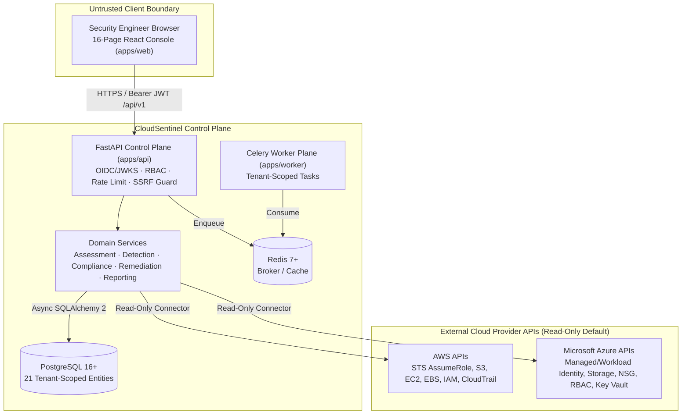

# System Architecture — CloudSentinel

**Status**: Implemented v1.0.0 (Milestones 0–9 Complete)

---

## 1. Architectural Overview

CloudSentinel uses a **hybrid, modular control-plane architecture**:
- **Control Plane API (`apps/api`)**: Stateless FastAPI service exposing `/health`, `/ready`, and versioned `/api/v1/*` REST endpoints with pure ASGI middleware (`RequestIdMiddleware`, `SecurityHeadersMiddleware`, `RateLimitMiddleware`) and strict CORS.
- **Async Worker Plane (`apps/worker`)**: Celery workers connected to Redis for tenant-scoped background assessment execution (`cloudsentinel.assessments.dispatch`) and operational health (`cloudsentinel.system.ping`).
- **Web Console (`apps/web`)**: 16-page React 19 + TypeScript + Vite + Tailwind v4 enterprise SPA communicating exclusively with `/api/v1/*` APIs using Bearer JWT tokens (never holding cloud credentials).
- **Persistence Layer (`packages/db`, `database/migrations`)**: SQLAlchemy 2 async ORM modeling all 21 core entities with UUID PKs, UTC timestamps, `JSONB` (SQLite `JSON` test variant), Alembic migration `0001_initial_schema`, and strict `tenant_id` scoping.
- **Authentication & Authorization (`packages/auth`)**: OIDC JWT/JWKS verification (`PyJWT`), five-role RBAC matrix enforced at both FastAPI route dependencies and domain service methods.
- **Shared Domain Packages (`packages/`)**:
  - `packages/common`: Validated `Settings`, structured JSON logging, recursive secret redaction, SSRF outbound URL validation.
  - `packages/contracts`: Shared Pydantic v2 operational and domain schemas (`system.py`, `domain.py`).
  - `packages/assessment`: Common `CloudProviderConnector` ABC, canonical `CheckStatus`, and transparent 0–100 risk engine.
- **Cloud Connectors (`cloud_connectors/`)**: Isolated read-only AWS (`aws/`) and Microsoft Azure (`azure/`) adapters implementing `CloudProviderConnector`.
- **Detection, Compliance & Policy Modules**: `detections/` (CloudTrail/Activity Log rules & MITRE ATT&CK), `compliance/` (CIS/NIST/ISO catalog & evaluator), `policies/opa/` (Rego guardrails).

## 2. High-Level Component Diagram

## 3. Trust Boundaries

1. **TB-1: Browser ↔ Control Plane API**
   - All client inputs are untrusted. Enforces Pydantic v2 validation, CORS allowlist, security headers, sliding-window rate limiting (`429`), OIDC JWT verification, and server-derived `tenant_id` (validated against `memberships`).
2. **TB-2: Control Plane API ↔ Worker Plane (via Redis)**
   - Worker tasks require explicit verified `tenant_id` and `connection_id` context and never operate unscoped.
3. **TB-3: Connectors ↔ External Cloud Providers (AWS / Azure)**
   - Outbound-only read-only API calls using short-lived STS credentials or Azure Managed/Workload Identity with explicit connect/read timeouts, retries, pagination, and partial-failure capture. All returned provider data is redacted before persistence.
4. **TB-4: Assessment Identity ↔ Remediation Identity**
   - Remediation defaults to `dry_run` preview and verification; live mutations are disabled by default (`CLOUDSENTINEL_LIVE_REMEDIATION_ENABLED=false`) and require separate remediation role credentials (`CLOUDSENTINEL_REMEDIATION_AWS_ROLE_ARN`), explicit human approval, and separation of duties (`approver != proposer`).

## 4. Architecture Decision Records (ADRs)

- **ADR-001 (Monorepo Layout)**: Unified repository keeping contracts, API, worker, connectors, detection rules, compliance mappings, IaC policies, tests, and frontend strictly synchronized.
- **ADR-002 (Pure ASGI Middleware)**: `RequestIdMiddleware`, `SecurityHeadersMiddleware`, and `RateLimitMiddleware` are implemented as pure ASGI classes (avoiding Starlette `BaseHTTPMiddleware` streaming/cancellation quirks).
- **ADR-003 (Honest Readiness & Check Outcomes)**: `GET /ready` performs bounded `asyncpg` and `redis.asyncio` probes returning HTTP `503` when dependencies are unreachable; cloud check failures return `ERROR`/`NOT_ASSESSED` and are never coerced to `PASS`.
- **ADR-004 (Cross-Dialect JSONB Variant)**: `packages/db/base.py` defines `JSONB().with_variant(JSON(), "sqlite")` so PostgreSQL 16 migrations use native `JSONB` while local async integration/security tests execute deterministically against `sqlite+aiosqlite` without requiring Docker on the dev host.
- **ADR-005 (Separation of Duties in Remediation)**: `approve_remediation()` explicitly rejects self-approval (`remediation.proposed_by == auth.user_id`) at the service layer as well as the API boundary.
