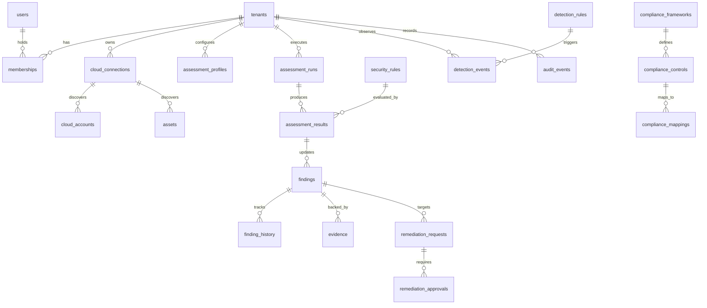

# Database Schema Design — CloudSentinel

**Engine**: PostgreSQL 16+ (with SQLite `JSON` dialect variant in `packages/db/base.py` for local async test suites)  
**ORM & Migrations**: SQLAlchemy 2 (`packages/db/models.py`) + Alembic (`0001_initial_schema.py` + `0002_postgres_rls_policies.py`)  
**Status**: **Implemented (All 21 Entities + PostgreSQL Row-Level Security Policies Live)**

---

## 1. Implemented Design Conventions

- **Primary Keys**: `UUID` (`Uuid(as_uuid=True)`, `default=uuid.uuid4`).
- **Timestamps**: Timezone-aware UTC `DateTime(timezone=True)` (`utcnow()`).
- **Multi-Tenancy**: Every tenant-owned table enforces a non-null indexed `tenant_id UUID NOT NULL REFERENCES tenants(id) ON DELETE CASCADE` and composite tenant-leading indexes.
- **Provider Metadata**: `JSONBVariant = JSONB().with_variant(JSON(), "sqlite")` for flexible, redacted AWS/Azure attributes.
- **Deduplication**: Unique constraints on `(tenant_id, provider, account_ref, resource_id)` for `assets` and `(tenant_id, rule_id, resource_id)` for `findings`.
- **Zero Raw Credentials Policy**: `cloud_connections` stores only non-secret identity metadata (`role_arn`, `external_id`, `azure_tenant_id`, `azure_client_id`, `secret_ref`) — never raw access keys or passwords.

---

## 2. Entity-Relationship Diagram (Implemented)

---

## 3. Implemented Tables (`packages/db/models.py`)

1. `tenants` — Isolation root, slug, active status.
2. `users` — `(oidc_issuer, oidc_subject)` unique OIDC identity, email, display name.
3. `memberships` — `(tenant_id, user_id)` unique RBAC role binding.
4. `cloud_connections` — AWS/Azure connector config, auth mode, preflight summary, `data_source`.
5. `cloud_accounts` — Verified AWS Account IDs and Azure Subscription IDs.
6. `assets` — Deduplicated discovered cloud resources, tags, redacted config, discovery/observation timestamps.
7. `assessment_profiles` — Custom rule profiles per provider.
8. `security_rules` — Versioned deterministic security check catalog.
9. `assessment_runs` — Run status, PASS/FAIL/NOT_ASSESSED/ERROR counts, partial failures JSONB.
10. `assessment_results` — Per-check, per-resource evaluation outcomes.
11. `findings` — Deduplicated security findings with risk score, risk explanation JSONB, remediation guidance, limitations.
12. `finding_history` — Audit history of open/resolved/risk_accepted/false_positive transitions.
13. `evidence` — Redacted expected vs. observed configuration snapshots.
14. `detection_rules` — Versioned deterministic CloudTrail/Activity Log rules + MITRE ATT&CK metadata.
15. `detection_events` — Triggered threat alerts with correlation IDs and false-positive disposition.
16. `compliance_frameworks`, `compliance_controls`, `compliance_mappings` — Compliance reference tables.
17. `remediation_requests` — Proposal, impact analysis, rollback guidance, `proposed_by`, `approved_by`, `executed_by`, verification evidence.
18. `remediation_approvals` — Recorded approve/reject decisions and reviewer comments.
19. `audit_events` — Append-only immutable tenant security audit trail.
