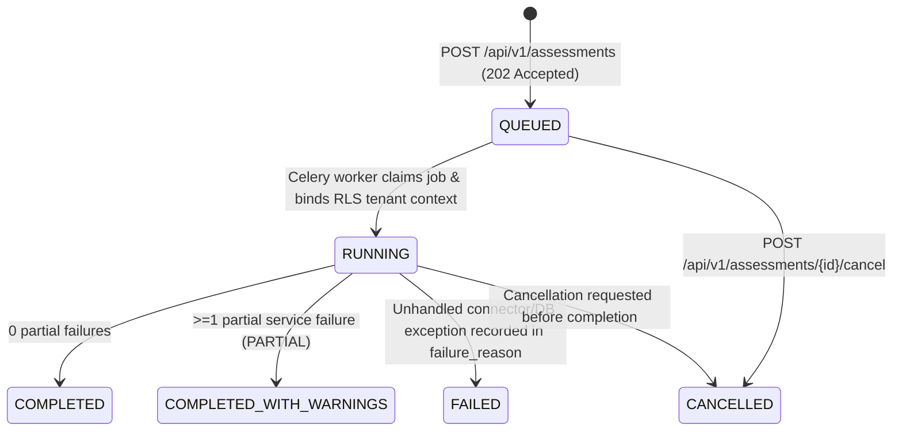

# CloudSentinel — Asynchronous Assessment Orchestration Specification

**Phase**: Phase 3 (`P1`)  
**Implementation**:
- [apps/api/services/assessment_service.py](file:///c:/Users/Arun%20G/Downloads/CLOUDSENTINEL/apps/api/services/assessment_service.py)
- [apps/worker/celery_app.py](file:///c:/Users/Arun%20G/Downloads/CLOUDSENTINEL/apps/worker/celery_app.py)
- [apps/api/api/v1/cspm.py](file:///c:/Users/Arun%20G/Downloads/CLOUDSENTINEL/apps/api/api/v1/cspm.py)

---

## 1. Assessment Lifecycle & State Machine

---

## 2. Reliability & Security Controls

1. **Non-Blocking Event Loop**: Synchronous provider SDK collection (`boto3` and `httpx.Client`) runs inside `asyncio.to_thread(...)` or a dedicated Celery worker process so the FastAPI event loop is never blocked.
2. **Per-Connection Concurrency Guard & Idempotency**:
   - If `idempotency_key` matches an existing run for the tenant, the existing run is returned idempotently.
   - If an assessment run for the target `connection_id` is already in `queued` or `running` status, `POST /api/v1/assessments` returns `409 Conflict`.
3. **Worker Tenant & Connection Re-Validation**:
   - The Celery worker task (`cloudsentinel.assessments.dispatch`) never trusts raw task arguments without binding `set_postgres_tenant_context(session, tenant_uuid)`, calling `verify_postgres_tenant_context(session, tenant_uuid)`, and verifying that `AssessmentRun.tenant_id == CloudConnection.tenant_id == tenant_uuid`.
4. **Bounded Retries & Crash Recovery**:
   - Worker task configures `max_retries=3`, exponential backoff, and jitter for transient transport errors; terminal errors transition the run to `status="failed"` with `failure_reason` persisted in PostgreSQL.
5. **Endpoints**:
   - `POST /api/v1/assessments` (`202 Accepted` / `201 Created`)
   - `GET /api/v1/assessments/{id}`
   - `GET /api/v1/assessments/{id}/results`
   - `POST /api/v1/assessments/{id}/cancel`
