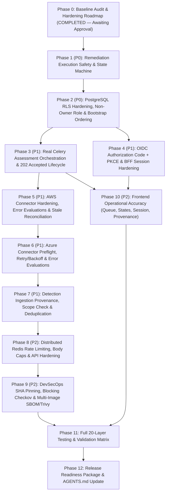

# CloudSentinel — Security Hardening & Production Engineering Roadmap

**Branch**: `hardening/cloudsentinel-security-validation`  
**Baseline Commit**: `82596087a067589e1bf719e330534e0f7cdc3d40`  
**Companion Audit**: [docs/audits/BASELINE_AUDIT.md](file:///c:/Users/Arun%20G/Downloads/CLOUDSENTINEL/docs/audits/BASELINE_AUDIT.md)

---

## 1. Execution Sequence & Dependency Graph

---

## 2. Phase-by-Phase Engineering Plan

### Phase 1 — Remediation Execution Safety (`P0`, Fixes `F-01`)
- **Objective**: Eliminate simulated remediation verification and unverified finding resolution; enforce a strict state machine (`DRAFT`, `PENDING_APPROVAL`, `APPROVED`, `EXECUTING`, `EXECUTED_UNVERIFIED`, `VERIFYING`, `VERIFIED`, `FAILED`, `REJECTED`, `CANCELLED`, `ROLLBACK_REQUIRED`, plus explicit `DRY_RUN_SIMULATED` outcome).
- **Files Modified / Created**:
  - `database/migrations/versions/0003_security_hardening_schema.py` (adds `idempotency_key`, `operation_id`, `verification_rule_id`, `verification_status`, `failure_reason`, `executed_at`, `verified_at` to `remediation_requests`)
  - `packages/db/models.py`, `packages/contracts/domain.py`
  - `apps/api/services/remediation_service.py`, `apps/api/api/v1/operations.py`
  - `tests/unit/test_remediation_state_machine.py`, `tests/security/test_authz_tenancy_and_hardening.py`
  - `docs/security/REMEDIATION_SAFETY.md`
- **Acceptance Criteria**:
  1. Dry-run (`confirm_live=False`) transitions to `DRY_RUN_SIMULATED` (never `VERIFIED`) and **never** resolves any finding (`live` or `synthetic_fixture`).
  2. Approval transitions to `APPROVED` without executing or resolving anything; self-approval is rejected (`403`).
  3. Live execution (`confirm_live=True`) requires `CLOUDSENTINEL_LIVE_REMEDIATION_ENABLED=true`, separate remediation credentials, allowlisted `action_type`, resource/account scope match, and an implemented provider executor + post-mutation reassessment verifier; otherwise returns `501 Not Implemented` / `403 Forbidden` and never resolves the finding.
  4. Duplicate/concurrent execution requests with the same remediation ID or idempotency key are rejected (`409 Conflict`).
- **Rollback**: Alembic `downgrade` on `0003`; state-machine accepts legacy `"previewed"` as alias for `"pending_approval"` in read paths.

---

### Phase 2 — PostgreSQL Tenant Isolation & RLS Hardening (`P0`, Fixes `F-02`)
- **Objective**: Make PostgreSQL Row-Level Security a true defense-in-depth control that cannot be bypassed by the runtime database role and fails closed when tenant context is missing.
- **Files Modified / Created**:
  - `database/migrations/versions/0003_security_hardening_schema.py` (`FORCE ROW LEVEL SECURITY`, explicit `USING (...) WITH CHECK (...)` policies, bootstrap lookup function / policy, non-owner `cloudsentinel_app` role setup)
  - `packages/db/session.py` (transaction-scoped `set_config('app.current_tenant_id', :tid, true)`, context verification helper, and session-close reset)
  - `packages/auth/dependencies.py` (bind `app.current_tenant_id` from verified JWT `claims.tenant_id` **before** querying `memberships`)
  - `tests/security/test_postgres_rls_isolation.py`
  - `docs/security/TENANT_ISOLATION.md`
- **Acceptance Criteria**:
  1. All 14+ tenant-scoped tables enforce `ENABLE ROW LEVEL SECURITY` and `FORCE ROW LEVEL SECURITY` with both `USING` and `WITH CHECK` clauses.
  2. Unscoped queries (`SELECT`, `INSERT`, `UPDATE`, `DELETE`) without `app.current_tenant_id` return 0 rows or fail closed under `cloudsentinel_app`.
  3. Connection pooling never leaks `app.current_tenant_id` across sequential requests.

---

### Phase 3 — Real Celery Assessment Orchestration (`P1`, Fixes `F-03`)
- **Objective**: Decouple cloud collection from the FastAPI request thread into a reliable, tenant-validated Celery worker pipeline with `202 Accepted` status, progress tracking, concurrency guards, and cancellation.
- **Files Modified / Created**:
  - `packages/db/models.py` & `0003_security_hardening_schema.py` (add `job_id`, `idempotency_key`, `failure_reason`, `progress_pct`, `queued_at`, `cancelled_at` to `assessment_runs`)
  - `apps/worker/celery_app.py` (real `run_assessment_task` acquiring DB session, setting RLS tenant context, validating connection ownership, running connector with bounded retries/timeouts, and persisting results)
  - `apps/api/services/assessment_service.py` (`enqueue_assessment_run`, `cancel_assessment_run`, per-connection active-run concurrency lock)
  - `apps/api/api/v1/cspm.py` (`POST /api/v1/assessments` -> `202 Accepted`, `GET /api/v1/assessments/{id}`, `GET /api/v1/assessments/{id}/results`, `POST /api/v1/assessments/{id}/cancel`)
  - `tests/integration/test_worker_assessment_orchestration.py`
  - `docs/architecture/ASSESSMENT_ORCHESTRATION.md`
- **Acceptance Criteria**:
  1. `POST /api/v1/assessments` creates a `QUEUED` run record, dispatches safely (with eager/inline fallback only when explicitly configured for deterministic unit tests), and returns `202 Accepted`.
  2. Duplicate concurrent runs on the same `connection_id` are rejected (`409 Conflict`).
  3. Worker validates tenant + connection ownership before executing and records `COMPLETED`, `PARTIAL`, `FAILED`, or `CANCELLED` accurately.

---

### Phase 4 — Authentication & Session Security (`P1`, Fixes `F-04`)
- **Objective**: Replace raw JWT copy-paste as the primary login experience with standards-based OIDC Authorization Code Flow with PKCE and `HttpOnly` BFF session cookies, while keeping synthetic demo mode strictly disabled unless explicitly enabled in development/preview.
- **Files Modified / Created**:
  - `packages/auth/oidc.py` (PKCE `code_verifier`/`code_challenge`, `state`, `nonce`, OIDC discovery/token exchange, signed/encrypted BFF session cookie & CSRF token verification)
  - `packages/auth/dependencies.py` (accept either `HttpOnly` session cookie + `X-CSRF-Token` on mutations OR `Authorization: Bearer` header)
  - `apps/api/api/v1/system.py` / `apps/api/api/v1/auth.py` (`GET /api/v1/auth/oidc/config`, `POST /api/v1/auth/oidc/authorize`, `POST /api/v1/auth/oidc/callback`, `POST /api/v1/auth/logout`)
  - `apps/web/src/pages/LoginPage.tsx`, `apps/web/src/lib/api.ts` (OIDC PKCE login primary button; gate synthetic demo sandbox behind `VITE_ENABLE_DEMO_SANDBOX === "true"`)
  - `tests/security/test_oidc_pkce_and_sessions.py`
  - `docs/security/AUTHENTICATION_MODEL.md`

---

### Phase 5 — AWS Connector Validation & Error/Stale Reconciliation (`P1`, Fixes `F-05`)
- **Objective**: Ensure every AWS service failure or permission gap emits explicit `NOT_ASSESSED` or `ERROR` rule evaluations (never silently skipped), resolve true S3 bucket regions, reconcile stale findings safely, and surface identity collection errors.
- **Files Modified / Created**:
  - `cloud_connectors/aws/connector.py`, `cloud_connectors/aws/rules.py`
  - `apps/api/services/assessment_service.py`, `apps/api/api/v1/operations.py` (scope compliance posture to latest assessment run per connection; mark stale findings)
  - `tests/unit/test_aws_connector_mocked.py`
  - `docs/validation/AWS_VALIDATION.md`

---

### Phase 6 — Azure Connector Validation, Preflight & Retry Backoff (`P1`, Fixes `F-06`)
- **Objective**: Verify actual Azure subscription `Reader` access during preflight (`GET /subscriptions/{id}`), add bounded retry/backoff for HTTP `429`/`5xx` and cycle-safe `nextLink` pagination, and emit explicit `NOT_ASSESSED`/`ERROR` evaluations on service failures.
- **Files Modified / Created**:
  - `cloud_connectors/azure/connector.py`, `cloud_connectors/azure/rules.py`
  - `tests/unit/test_azure_connector_mocked.py`
  - `docs/validation/AZURE_VALIDATION.md`

---

### Phase 7 — Detection Pipeline & Evidence Integrity (`P1`, Fixes `F-07`)
- **Objective**: Prevent client-spoofed `data_source="live"` detections, validate that ingested `account_ref` belongs to an active tenant `CloudConnection`, enforce strict timestamp/schema validation, and deduplicate events by `(tenant_id, provider, provider_event_id, rule_id)`.
- **Files Modified / Created**:
  - `packages/db/models.py` & `0003_security_hardening_schema.py` (`provider_event_id` column + unique constraint on `detection_events`)
  - `detections/engine.py`, `apps/api/api/v1/operations.py`, `packages/contracts/domain.py`
  - `tests/security/test_detection_ingestion_integrity.py`
  - `docs/security/DETECTION_EVIDENCE.md`

---

### Phase 8 — Distributed Redis Rate Limiting & API Hardening (`P2`, Fixes `F-08`)
- **Objective**: Replace process-local rate limiting with a Redis-backed sliding/fixed-window rate limiter with per-route-class quotas, bounded LRU fallback when Redis is unavailable, trusted proxy IP extraction, and request body size limits.
- **Files Modified / Created**:
  - `apps/api/core/middleware.py`, `apps/api/main.py`, `packages/common/config.py`
  - `tests/security/test_rate_limiting_and_hardening.py`
  - `docs/security/API_HARDENING.md`

---

### Phase 9 — DevSecOps & Supply Chain Hardening (`P2`, Fixes `F-09`)
- **Objective**: Pin all GitHub Actions to reviewed 40-char commit SHAs, replace archived `semgrep-action@v1` with direct `semgrep` CLI execution, make Checkov blocking with documented lab skips, scan & generate SBOMs for all 3 images (`api`, `worker`, `web`), and validate `release_version` SemVer format.
- **Files Modified / Created**:
  - `.github/workflows/ci.yml`, `.github/workflows/release.yml`, `.github/workflows/cloud-lab-prowler.yml`
  - `infrastructure/terraform/aws/main.tf`, `infrastructure/terraform/azure/main.tf` (scoped Checkov skip annotations for ephemeral sandbox-only storage replication/CMK)
  - `docs/devsecops/SUPPLY_CHAIN_SECURITY.md`

---

### Phase 10 — Frontend Operational Accuracy (`P2`)
- **Objective**: Align the React 19 UI with the hardened backend contracts (`202 Accepted` assessment queue/progress polling, full remediation state machine badges and verification outcomes, OIDC PKCE sign-in, explicit `NOT_ASSESSED`/`ERROR` states, and gated demo sandbox).
- **Files Modified**:
  - `apps/web/src/lib/api.ts`, `apps/web/src/pages/{DashboardPage,AssessmentsPage,RemediationPage,LoginPage,CloudEnvironmentPage,IdentityPage}.tsx`, `apps/web/src/components/Badges.tsx`, `apps/web/src/App.test.tsx`

---

### Phases 11 & 12 — Full 20-Layer Validation Matrix, Release Readiness Package & `AGENTS.md` Update
- **Deliverables**:
  - Execute all automated test layers and record honest `PASS` / `FAIL` / `BLOCKED` / `NOT_RUN` evidence in:
    - `docs/release/VALIDATION_MATRIX.md`
    - `docs/release/RELEASE_READINESS.md`
    - `docs/release/SECURITY_ACCEPTANCE.md`
    - `docs/release/KNOWN_LIMITATIONS.md`
    - `docs/release/DEPLOYMENT_RUNBOOK.md`
    - `docs/release/ROLLBACK_RUNBOOK.md`
  - Update root `AGENTS.md` with all mandatory engineering & release gates.

---

## 3. Owner Approval Request

To proceed from **Phase 0** into **Phases 1–12**, please confirm:
1. Approval of the **Phase 1–12 sequence** and schema migration `0003_security_hardening_schema` on branch `hardening/cloudsentinel-security-validation`.
2. Approval of the `POST /api/v1/assessments` contract update to return `202 Accepted` for queued runs (with frontend polling/status support).
3. Whether live AWS/Azure cloud sandbox credentials are available for Phases 5–6 (`NOT_RUN` will be explicitly recorded for live cloud lab tests unless you provide sandbox approval and credentials).
