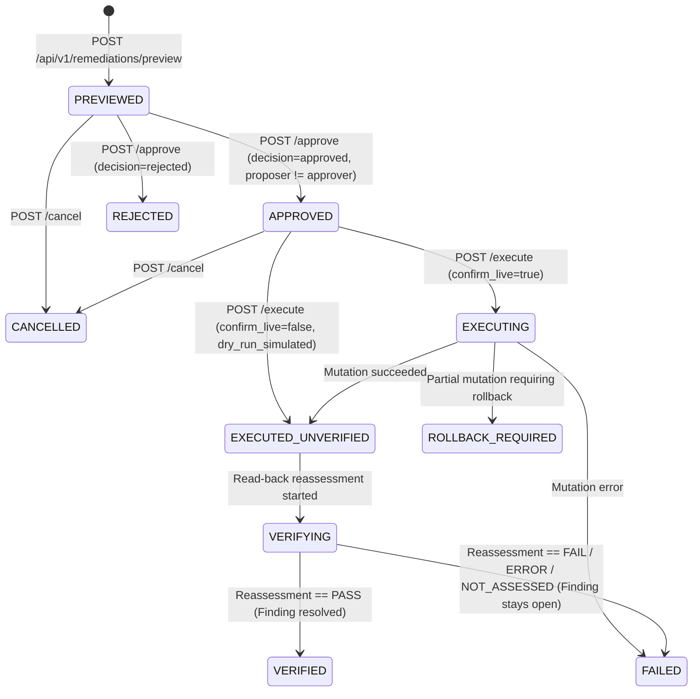

# CloudSentinel — Remediation Execution Safety Specification

**Phase**: Phase 1 (`P0`)  
**Implementation**: [apps/api/services/remediation_service.py](file:///c:/Users/Arun%20G/Downloads/CLOUDSENTINEL/apps/api/services/remediation_service.py)

---

## 1. Security Invariants

1. **Read-Only Default**: Live cloud remediation is disabled by default (`CLOUDSENTINEL_LIVE_REMEDIATION_ENABLED=false`).
2. **Dry-Run Never Resolves Findings**: Executing a remediation in dry-run mode (`confirm_live=false`) records a dry-run simulation (`stage="executed_unverified"`, `execution_mode="dry_run"`, `verification_status="dry_run_simulated"`) and **never** transitions the request to `verified` or resolves the associated `Finding` (neither for `live` nor for `synthetic_fixture` records).
3. **Approved != Executed != Verified**:
   - `approve_remediation()` transitions `previewed` / `pending_approval` -> `approved` (or `rejected`) enforcing strict **Separation of Duties** (`proposer != approver`).
   - `execute_remediation()` transitions `approved` -> `executing` -> `executed_unverified` -> `verifying` -> `verified` (or `failed` / `rollback_required`).
4. **No Simulated Live Success**: If `confirm_live=true` is requested when no live provider executor is registered for the action, the service transitions the request to `failed`, logs `remediation.execution_rejected` in `audit_events`, and raises `UnsupportedRemediationOperationError` (`HTTP 501 Not Implemented`).
5. **Reassessment Proof Required**: A `Finding` is automatically resolved (`status="resolved"`) **only** when a post-mutation reassessment check for the exact `rule_id` and `resource_id` returns `CheckStatus.PASS`.
6. **Tamper-Evident Evidence**: Every `verification_evidence` payload includes a canonical SHA-256 digest (`integrity_sha256`), redacted provider response, `operation_id`, `verification_rule_id`, and UTC timestamps.

---

## 2. State Machine

